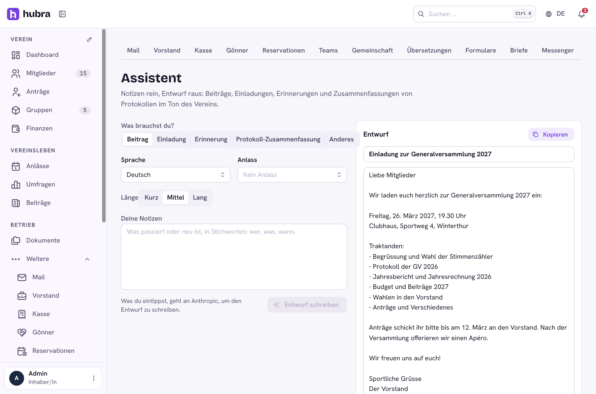
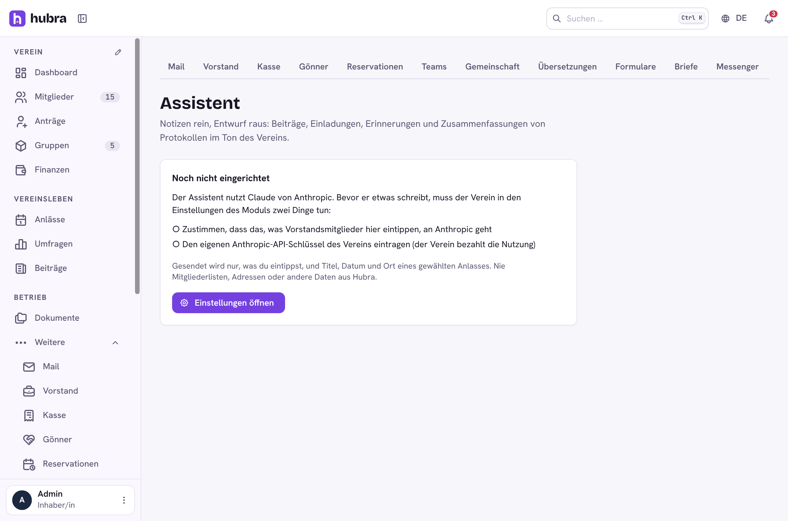
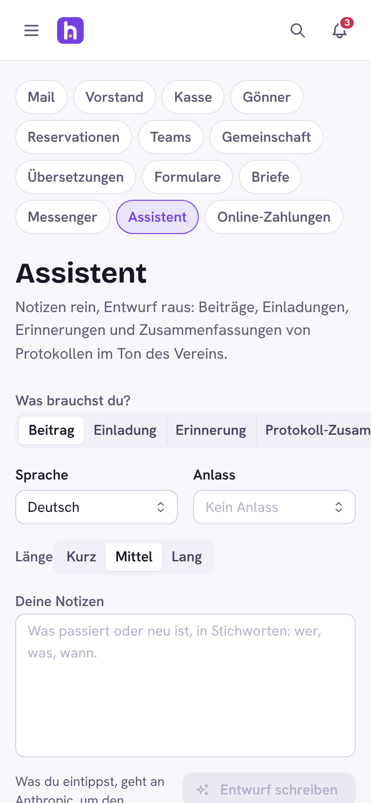

# Assistant

[](https://github.com/hubra-app/hubra-plugin-assistant/actions/workflows/release.yml?query=branch%3Amain) [](https://github.com/hubra-app/hubra-plugin-assistant/releases/latest) [](LICENSE)

A plugin for [Hubra](https://hubra.club). Writing help for the board: a few notes in, a draft out (a post, an invitation, a reminder, a summary of minutes, or anything else), in the club's tone and language. Written by Claude (Anthropic) with the club's own API key, and only after the club agrees.

**Version** 1.1.0 · **Works with** Hubra >=0.2.3,<1 · **Plugin id** `assistant` · **Needs** the members module



## What it does

- **Five kinds of text:** post, invitation (with an upcoming event's title, date and place if you pick one), reminder, minutes summary (paste up to 60,000 characters) and anything else.
- **The club's voice:** German as written in Switzerland («ss»), French, Italian or English; «du» or «Sie» and a sentence about the club's tone, set once in the module's settings. Missing facts become placeholders like `[Datum]` instead of invented ones.
- **Edit and copy:** the draft is editable and copied with one click. Each person sees their own last 30 drafts.

## Data and consent

Nothing is sent anywhere until the club, in the module's settings, switches on **Send our notes to Anthropic** and enters its **own Anthropic API key** (from console.anthropic.com; the club pays Anthropic for its use). Then only what the board member types, and the title, date and place of an event they pick, goes to Anthropic's API. Never member lists, addresses or other data from Hubra. The page says so next to the button.

Before sending, members' names (as spelled in Hubra: the full name, and a first or last name only one member has), mail addresses, phone numbers and IBANs are replaced with placeholders like `[Person 1]` or `[E-Mail 1]`; Hubra puts them back into the draft that comes back. A name spelled differently, or someone who isn't a member, goes as typed.

- Model: Claude Opus 5.5 by default; Sonnet 5.5 or Haiku 5.5 cost less.
- Each person may write 30 drafts an hour, and the whole club 100 a day (setting **Drafts per day for the whole club**, 0 for no cap). Deleting drafts doesn't free up more.
- Drafts, with the notes and minutes they came from, are deleted after 90 days (setting **Keep drafts for (days)**) by a daily job, and once their author is no longer a member. Deleting a draft is recorded in the audit log.
- The key is stored encrypted and never shown in errors.
- The plugin calls `https://api.anthropic.com/v1/messages` over plain HTTPS (plugins can't bring Python packages), with structured output (title and text) and, on Opus and Sonnet, Anthropic's server-side fallback when a request is declined.

The page needs the permission `assistant.drafts.update`; picking an event also needs `events.read`.

| Not set up yet | Phone |
| --- | --- |
|  |  |

## Install

Platform admins install it from the Plugin catalogue in manage
(official Marketplace, <https://plugins.hubra.club/index.json>, signed with
the Hubra project key). Clubs then switch it on under Einstellungen → Module.

## Develop

Clone this repository into `plugins/assistant` of a Hubra checkout. Its tests
then run with Hubra's (`cd app/backend && pytest ../../plugins/assistant`), and
`npm run build:plugin` in `app/frontend` builds its frontend. The workflow
does the same against Hubra's `main` on every push and pull request.

## Releasing

Bump `version` in `plugin.yaml`, add a `## <version>` section to
`CHANGELOG.md` and merge. Then tag the merged commit on main and push the tag:

```sh
git switch main && git pull
git tag v<version> && git push origin v<version>
```

The workflow tests the plugin and builds its frontend, the `plugin-signing`
job signs it after your approval, and only then is the GitHub release
`v<version>` published, with `assistant-<version>.zip` and its `.sha256` attached.
Files listed in `.releaseignore` stay out of the zip. Releases are immutable,
so a published version never changes: fix a bad one with a new version.

Source: <https://github.com/hubra-app/hubra-plugin-assistant>
